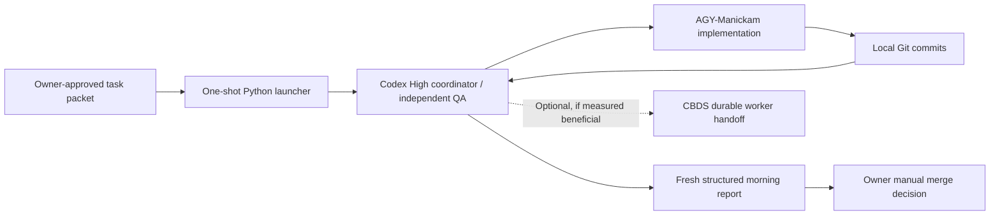

# MK Nightshift + NutriSnap: CURRENT roadmap (2026-10-22)

> **21:05 IST scheduled proof update (22 Oct):** systemd timers fired correctly at 20:30 and 21:05, but both attempts safely sent **zero Codex prompts** because the interactive TUI entered transcript-selection mode. W03 did not run. The approved High effort and offline-safe readiness guard were correct on second attempt; **do not schedule a third TUI retry**. Current action: [prove official non-interactive `codex exec` as a minimally changed scheduler transport](v0.6/STOP_TUI_POLLING_HEADLESS_CODEX_DISPATCH_2026-10-22.md). No new timer has been installed. Prior V0.5 Gate C and W04 success remain intact.

**Read this first; this is the current planning dashboard.** It is NOT an authorization to modify production, merge branches, install scheduling or globally switch task dispatch to CBDS. Source: owner-provided OpenClaw execution receipts and GitHub planning/source review. Unpushed OpenClaw commits cannot be independently fetched from this remote instruction branch.

## Two different version numbers

1. **MK Nightshift V0.5** = the multi-agent one-shot development mechanism. **Proven PASS** in the user-reported Gate C run. Not yet an unattended recurring nightly service.
2. **NutriSnap V0.5** = a separate **future product release** (career/income, skills, assets) in `MKCyberLabs/NutriSnap/docs/roadmap/VERSION_TRACKER.md` (dated Oct 12, status PLANNED). **Do not claim that NutriSnap product V0.5 was implemented just because Nightshift V0.5 passed.** Existing remote product tracker can lag local feature branches.

## Verified/reported accomplishments — do not repeat

| Result | Evidence owner reported | Status |
|---|---|---|
| NS-01 meal category | AGY implementation `0ff42c6a28d203e3ccaf9cc37fba2ae693ddeb2d`, independent Codex tests PASS | DONE local |
| NS-02 recurring budget | AGY `8372df220e9117725bd472dd6b430e3f8c444bf5`, 1 repair + QA PASS | DONE local |
| Gate B launcher | `b3e91d44d0ab5d474578ccc0de5f62f2a3e7402f`, 22 offline tests | DONE |
| Gate C one-shot | Launcher repair `45d7e8285617d1c231417d2ed643d7581d740911`, finance/reminders `9934c6261c728c5a0dba9954b781a8b03fe29c12`, independent QA PASS, final launcher 0/`REVIEW_REQUIRED` per Astra host audit | **Nightshift V0.5 DONE** (one-shot) |
| W04 weekly hydration average | `8a13c3c77250b829292fd47f28365b34cda6425e`; Manickam recovery; 40 test executions + 6 browser checks PASS; 1 repair; clean local unmerged worktree | **W04 DONE locally**, merge pending |
| CBDS 2.3.0 / Herdr 0.9.1 experiment | One authenticated AGY read-only task; `cbds done`→`cbds wait` 89.6 sec, durable re-read; 1 startup, 1 prompt, 0 transcript polls; worker token usage unknown. Local report `docs/v0.6/CBDS_TRIAL_RESULT_2026-10-22.md`, docs SHA `a62590fd9a2e9d149a3467acdc1c727aa2a555fa` | **Protocol PASS, token savings NOT PROVEN**; NOT adopted globally |

All Git promotion is held under `PUSH_HOLD`. The original dirty NutriSnap checkout was preserved, no automatic push/merge/deploy and no recurring scheduler were enabled.

## Roadmap Track A — Nightshift operational maturity

| Priority | Deliverable | Exit test / proof | Decision |
|---|---|---|---|
| **A0 NOW** | **Owner merge/evidence review** of NutriSnap NS-01/02/Gate C/W04 local branch, plus Nightshift launcher evidence. Confirm branch/base, changes, tests, conflict with current main and any 6 AM merge tooling. | Owner sees clean diff/commits, chooses selective merge or HOLD; no auto-merge | Owner review |
| **A1 NEXT** | **One-command usability**: show exact tested task-packet location, how existing Python one-shot runner starts from plain shell, how a missing AGY builder is rediscovered/restarted, and where status/report appears. Reuse code; no seat manager | A new task can be initiated without reconstructing a huge CLI transcript or blind-prompting agents | Develop only if real usability gap |
| **A2** | **Repeat-run proof**: two or three distinct scoped development runs on real tasks, clean reports, isolated commits, safe retries/holds, no need for repeated owner chat messages | Demonstrates repeatability rather than one lucky pilot; no new framework | Codex + owner |
| **A3 OPTIONAL** | **CBDS A/B decision** on comparable real tasks under Herdr-only vs CBDS transport, collect coordinator+worker tokens (if available), model initial context cost, pane startups, waiting overhead, transcript reads, correctness | CBDS wins **measured** efficiency without new trust/seat/maintenance burden; otherwise continue Herdr direct. Do not install both as permanent authoritative ledgers | Owner after evidence |
| **A4 LATER** | **Unattended nightly scheduling** of previously approved task packet(s), single lock/time budget, no push/merge/deploy, morning notification/report, recovery/stop conditions | At least one unattended bounded night run PASS and owner reviews next morning; separately authorize timer | NOT AUTHORIZED YET |
| **A5 OPTIONAL** | **Herdr cockpit/status visibility** with known OpenClaw machine/session and reused panes | User can locate Codex, Manickam and run status without launching unnecessary agents | Low priority |

**DO NOT:** reopen H1–H5, rewrite launcher, add Python AI-like dispatcher, create many persistent agents, install CBDS globally just because `done`/wait works, turn on cron/auto-merge without owner decision, measure token savings from a quota-percent reading.

## Roadmap Track B — NutriSnap product work

| Priority | Product deliverable | Definition of done | Current status |
|---|---|---|---|
| **B0 NOW** | Review + promote approved completed local fixes (NS-01, NS-02, EMI/credit-card reminder consistency, W04) | Owner checks diff, real regression/browser evidence and target branch; manual selective merge after resolving `PUSH_HOLD` | Local QA PASS; unmerged |
| **B1 NEXT** | **W03 hydration date/time correction** (recommended by last CBDS trial). Determine actual symptom from local backlog/repro and source; public `main` did not surface a W03 specification. | Agree precise observed/expected date/time behavior, timezone and cross-midnight cases; one AGY implementation + independent Codex tests + browser UAT; clean local commit | Candidate, NOT STARTED |
| **B2** | Prioritized V0.4 stabilization, real user/mobile UAT and release checks | Complete existing blockers based on latest local evidence, not stale remote tracker or invented issues | Needs local status verification |
| **B3 LATER** | NutriSnap **product** V0.5.0 career/income, 0.5.1 education/skills, 0.5.2 assets | Implement one user-visible domain increment at a time with auth, database and release tests, only after approved V0.4 stabilization | Planned in `docs/roadmap/VERSION_TRACKER.md` |
| **B4 FUTURE** | Investments/protection → goals/scenarios → stable V1.0 | Follow separate product version tracker and release gates; avoid scope explosion | Planned |

**W03 default guardrails:** Inspect the local W03 bug report/feature request first; do **not** assume whether the issue is a UI date picker, stored timezone, edit timestamp or server data model. No production data migration or destructive correction without review. Test existing hydration log CRUD and W04 weekly average regressions so the new fix doesn't undo W04.

## Simple architecture / one goal

### One operating principle: doghouse lamp, not moon generator

Build the smallest shippable user improvement, verify it once properly and move to the next. Stop adding architectural phases when the code and independent tests already pass.

## Immediate recommended sequence (not multiple approval gates)

**Now:** Record this map as current truth; review the old local NutriSnap commits before promoting them, and inspect the actual W03 date/time issue from local history. **Then:** start **one meaningful W03 feature run** using working direct Herdr/Codex→Manickam; protect W04 and all unmerged commits. Collect a small run receipt with prompt/agent startup/count and tests. **Later:** decide whether to enable nighttime scheduling or adopt CBDS based on real need and measurements, not because remaining model quota is available.

**Current open decisions for owner:** (1) Review/promote the clean local NutriSnap night branch now or hold while feature work continues? (2) Enable nightly time-based scheduling later? (3) Invest in CBDS only after a comparable efficiency measurement or defer? **Suggested defaults:** manual merge review first; scheduling opt-in after repetitive clean runs; CBDS remain experimental.

**References:** `docs/v0.5/START_HERE_2026-10-22_DOGHOUSE_LIGHT.md`; `docs/v0.5/W04_HYDRATION_COMPLETE_RUN_PLAN_2026-10-22.md`; `docs/v0.6/CBDS_ONE_GO_EFFICIENCY_TRIAL_2026-10-22.md`; NutriSnap `docs/roadmap/VERSION_TRACKER.md` and `docs/roadmap/V05_TO_V10_LIFE_PLATFORM.md`.
