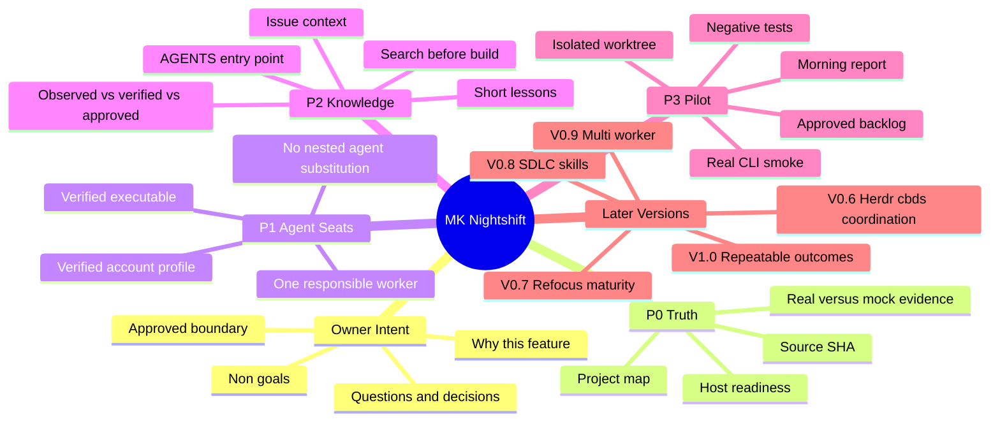

# Nightshift V0.5 → V1.0 mind map

This is a **planning visualization**, not permission to create extra agents or change the dispatcher.

A project specialist's remembered context is **documents plus verified evidence**, never implicit model memory. Start with one navigable map and follow the few links needed for this exact task.

Read [the roadmap](ROADMAP.md) for numbered steps and [the evidence checklist](P0_CHECKLIST.md) for review boundaries.
