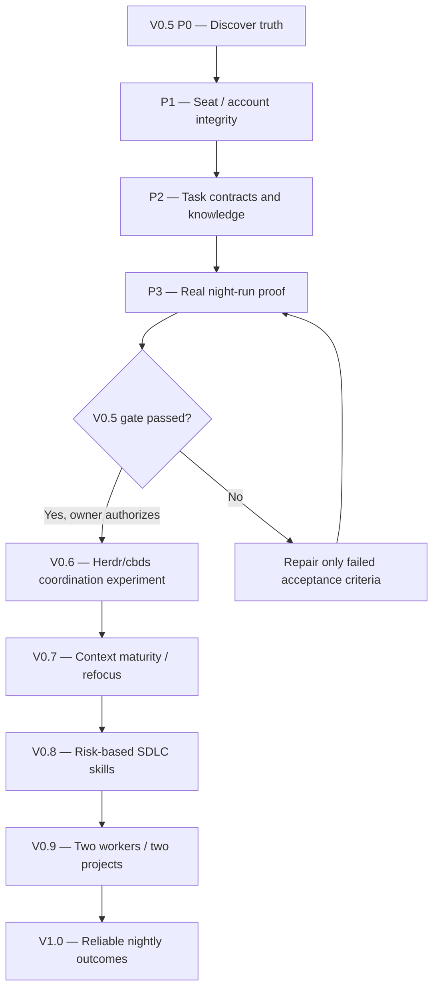

# MK Nightshift — phased roadmap

Planning baseline: 2026-10-19. **Updated 2026-10-20: Manual Codex and Herdr AGY-Rohit coding loops PASS (owner-reported); H4 integration NOT_STARTED; unattended Nightshift NOT APPROVED.** Later roadmap items remain proposals, not implementation permission.

## ✅ Progress scoreboard — owner review, 2026-10-19

This scoreboard is the short status summary. Historic phase descriptions below are future-oriented; **do not reset checked milestones** because an older plan mentions more ambitious tests.

| Outcome | Check | Evidence / scope |
|---|---|---|
| P0 — source, task contract, runner choice | ✅ **DONE** | Local planning/report commits reviewed via user-provided host reports; Python is sole task dispatcher |
| P1A — real Codex CLI launched by Python | ✅ **DONE** | One `TEST_ADD` real headless execution and host assertions PASS; fixture `06c84ae2bc1788c8c42046ad13b8de08cb387b97` |
| P1A — real worker logs/test/commit/stop | ✅ **DONE** | Evidence commit `2f772d8eb691f81abeabf4ff22f25aeb5730fd4d`; no retry or push |
| W02 — one real NutriSnap coding task through Python runner | ✅ **DONE** | Native Codex child PID 188615, launcher PID 188608; JSON `turn.completed`; runner exit 0; `W02_330ML=VERIFIED_COMMITTED` and campaign `REVIEW_REQUIRED` |
| W02 — exact 330 ml input implemented, local code committed | ✅ **DONE (implementation)** | NutriSnap `ee135be8173eea5ad499b23838e0a049c814e991` → local `e072c80cc50b5a5fe9a199d2b93b4059807331ba`; evidence `bb2c84a63197038734c9fe14297f203197c44093` |
| W02 — offline component / validator tests | ✅ **DONE** | Early component and validator PASS; latest isolated-DB UAT also reports component checks and typecheck PASS. Earlier isolated-run typecheck failure was reported as baseline diagnostics, not a proven W02 regression |
| W02 — browser reload, Water/Today totals and cross-user DB UAT | ✅ **DONE — UAT PASS (owner-reported host evidence)** | Real Chromium + disposable PostgreSQL: **26 PASS / 0 FAIL / 1 NOT_RUN** (optional production build); exact 330 ml, edits, navigation, refresh, Water/Today and cross-user denial; local evidence `af95af2fa037897f46f167b3dfa359b9bf9257eb`; code `e072c80cc50b5a5fe9a199d2b93b4059807331ba` |
| Herdr H1+H2 — first real named AGY seat + cockpit | ✅ **DONE (owner-reported)** | Existing Codex High `wD:p1` preserved; AGY-Rohit `wD:p4`, PID `225508`, Herdr `idle` / `interactive_ready=true`; Nightshift log pane `wD:p5`. One startup and one owner-approved worktree trust acceptance; local evidence `2901d2af391f10a0392cecc8d3bf09b3add2f2fc`. [Folder trust scope](approvals/HERDR_ROHIT_FOLDER_TRUST_2026-10-19.md) |
| Herdr H3 adapter / red human-attention stop | ✅ **DONE (offline)** | Python↔Herdr adapter local code `ab4917a2c3368e5c80a5d92ac208be731fb1903e`; **38 offline tests PASS**, local evidence `9ead870c1d18d901d0686df30c6fd1ee35bfc1c6`. AGY-Rohit `wD:p4` and Codex preserved. |
| Herdr H3 — first real AGY-Rohit task through Python | ✅ **DONE — MANUAL SCOPE (owner-reported)** | Active numeric manifest `2026.10.19.2` matched safe idle; 1 real prompt (0 retry); transient survey hold preserved; host-only acceptance PASS, 38 regressions + 11 detector cases PASS, task code `0a1fce571b3b0f7d6ee8f4460ddc04c9bb5f6430`, evidence `4d0cc99c101321b335314a0c4b09f3d9873eb6c9`. [H3 acceptance](reviews/H3_MANUAL_PASS_DISPOSITION_2026-10-20.md) |
| Herdr H4 — integrate proven adapter into maintained Python runner | ▶ **OWNER APPROVED — EXECUTION PENDING** | H3 manual PASS. Owner approved one narrow local code integration + offline tests, **zero additional agent prompts**, preserve human-attention holds and existing panes. [H4 instructions](../../prompts/V0.5_H4_INTEGRATE_PROVEN_HERDR_PATH.md) · [Approval](approvals/H4_PROVEN_HERDR_INTEGRATION_2026-10-20.md). Do not check H4 PASS until local test/commit evidence is reported. |
| Nightshift — unattended one-time no-push trigger and recovery | ☐ **AFTER SEAT PROOF — automation lane** | Manual runs proven. No timer installed or night automation activated |
| GitHub push, auto-merge, deployment, sensitive environment hardening | ⏸ **HOLD / LATER** | `PUSH_HOLD` persists; 6 AM merge scheduler context unverified; no production changes authorized |

**Meaning of DONE:** A completed scope stays checked. The **Nightshift manual build → host tests → local Git commit → report loop is demonstrated** on both a disposable fixture and a real W02 code task. **W02 development and isolated browser/database UAT are now checked DONE (owner-reported host evidence)**. The UAT report is in the local orchestration worktree at `docs/v0.5/evidence/W02_ISOLATED_DB_BROWSER_UAT.md`; its commit has not been fetched here due to `PUSH_HOLD`. The optional production build remains `NOT_RUN`, and no code push/merge/deployment is authorized. Do not reopen the already-proven manual worker-launch milestone.

**Source qualification:** These detailed process receipts, Git SHA results and test outcomes were supplied from OpenClaw by the owner. The remote instruction-branch reviewer cannot independently fetch OpenClaw-only commits/logs while `PUSH_HOLD` is active. Preserve this distinction without reopening redundant verification.

### Next outcomes — ordered tracks (not extra planning phases)

1. ✅ **NutriSnap W02 product UAT DONE (reported):** 26 Chromium/PostgreSQL tests PASS, 0 FAIL, optional production build NOT_RUN. Preserve local evidence commit `af95af2fa037897f46f167b3dfa359b9bf9257eb`, no repeat UAT unless change/regression. Product may undergo independent owner review before eventual Git promotion.
2. ✅ **Herdr H1+H2 DONE (reported):** AGY-Rohit is a real Herdr-recognized interactive seat, ready/idle, with a preserved Codex High operator and Nightshift log pane. Prior folder-trust blocker was resolved with owner-approved one-time acceptance. No duplicate trust prompts or more account verification. **H3 now DONE for manual scope (owner-reported):** corrected numeric manifest loaded, one AGY-Rohit prompt, 38 adapter + 11 detector PASS, host task acceptance and local Git SHA recorded. A transient survey hold required careful manual host verification—**not** unattended completion. **H4 is next**, integrating the proven adapter into the maintained Python runner without another worker task. **Role/layout policy:** [reuse existing panes, one worktree per task, not one new tab per task](SEAT_TOPOLOGY_MVP.md). Do not implement topology automation during this H3 fix.
3. **Unattended operation:** one approved time-bounded **no-push, no-merge** task starts without an operator prompt, recovers/stops safely, and produces morning report. Only then consider a daily timer, with clear owner approval and 6 AM Git scheduler safety.
4. **Release / expansion:** owner reviews and promotes local changes; only later broaden to two builders/two projects, production, push/merge and environment hardening.

**Working rule:** Keep checkmarks for completed manual worker/W02 implementation. Each follow-up phase should produce one visible running capability, not another broad security/architecture dossier. Stronger isolation and production push safety are deferred; they are not silently considered solved.

## Owner update — 2026-10-19: DEV-FIRST MVP (applies to one disposable P1A fixture)

The owner prioritizes **proving a working V0.5 Nightshift coding loop** on the existing OpenClaw development server, rather than further security-framework or multi-user setup. For **one manual disposable Codex TEST_ADD only**, use the existing `openclaw` user and privately owner-matched Codex CLI account, accept the explicitly documented residual same-user isolation risk, and run a single task with time/path limits, real host tests and local Git evidence. No new user, re-login, container, token decoding or renewed isolation reviews for this fixture. See [decision](decisions/DEV_FIRST_FIXTURE_POLICY_2026-10-19.md) and [one-task instruction](../../prompts/V0.5_P1A_DEV_SINGLE_TEST_ADD.md).

**Future hardening before broader unattended/sensitive use:** unprivileged worker isolation; reduced environment, mounts/sockets and egress; proof of headless identity where materially needed; service/timer and 6 AM Git merge safety. Existing `ISOLATION_NOT_VERIFIED` remains factually true. This temporary dev-first exception is not permission to access unrelated credentials, DBs, Telegram, services, or to push/merge/deploy.

## Definition of success

In the evening the owner approves one or two bounded issues. Overnight a verified, intended CLI account produces isolated, test-backed commits, or an honest blocker. In the morning a concise report cites real commits, commands, outcomes, identity evidence and next decisions. No unapproved promotion to production.

## Dependency graph

## V0.5 — Four gated phases

### P0: Verify truth and make project knowledge navigable (NO code edits in P0.1)
- **P0.1** Read-only inventory: orchestrator branch/HEAD/status, V0.4 runner/smoke/tests/timer, CLI help and auth viability (without exposing secrets), Herdr/cbds installed facts, existing host fixture evidence; NutriSnap branch pointers and conflicting docs.
- **P0.2** Architecture decision record: Python JSON runner is sole authoritative *night* dispatcher in V0.5; Herdr used for interactive control, cbds not dual-writing campaign state. Specify any proposed changes; no runtime edits yet.
- **P0.3** Propose a shallow NutriSnap `AGENTS.md` entrypoint to existing authoritative docs. Do not overwrite the NutriSnap repository without separate owner approval.
- **P0.4** Source-address map: app frontend/API, Prisma, shared scheduler, Python analysis API, Telegram adapter, isolated test setup, build/test commands. Each entry says verified/unverified.
- **P0.5** Evidence hierarchy: Git SHA + commands + logs for implementation, owner decisions for requirements, cbds or runner state for execution *only in the active chosen architecture*. No model narrative accepted as proof.
- **P0.6** Identify genuine blockers: verify both actual V0.4 smoke tasks `VERIFIED_COMMITTED` (not just `REVIEW_REQUIRED`), interruption recovery, account/profile, quotas, timer state, full real-project readiness.
- **P0 exit:** a fresh agent can locate the correct NutriSnap branch/SHA, reminders code, tests, non-goals and next approved issue in no more than two short entrypoint reads plus targeted links. Contradiction = HOLD.

### P1: Identity, chairs and handoffs
- Define **Owner** (intent/release), **Python Dispatcher** (only launcher), **Builder** (AGY-Rohit OR AGY-Manickam as verified selected), **Reviewer** (independent Codex when warranted).
- Registry fields: seat ID, real CLI executable/version, profile selector and redacted identity receipt, approved worktree, role/skill file, scoped task, time budget. Never store tokens, cookies or private authentication files in project docs.
- Worker requests a handoff, **dispatcher launches** real intended CLI; no nested/in-process agent substitution or undocumented quota fallback.
- Test both AGY identities in separate sandbox trials; test wrong profile, absent binary, expired login, duplicate task, invalid worktree and quota exhausted.
- **P1 exit:** attributable external launches for both account seats; wrong-identity negative test reliably BLOCKED. No real production changes.

### P2: Owner intent, issue and context contract
- One issue record: ID, desired user outcome and why, explicit approval, source branch/SHA, code/knowledge addresses, allowed paths, forbidden work, dependencies, acceptance commands, responsible seat, real question/decision route.
- Skills initially **three only**: Project Steward (find existing design first), Engineering Standards (SOLID/DRY/KISS/YAGNI/security and local conventions), SDLC Execution (plan/build/test/review/handoff). Load by task, not every skill every turn.
- Knowledge trust labels: PROPOSED (idea), OBSERVED (claim/measurement), VERIFIED (source/test backed), APPROVED (authorized product decision). VERIFIED is not automatic owner approval.
- Add a short **Lessons** note only for a reproducible failure: nested subagent substitution, stale V0.1 route, creating a second scheduler, lost review evidence, excessive architectural expansion.
- **P2 exit:** fresh AGY worker can find an existing service, explain the intended change, distinguish approved vs merely proposed behavior, ask one decision-quality question, and produce a bounded task plan.

### P3: Nightshift proof and safety
- Reproduce two disposable fixture tasks with **real headless CLI**, exact SHA, logs/tests and accepted report states. Mocked suite PASS does not satisfy live proof.
- One **separately approved** low-risk NutriSnap change in isolated Git worktree with isolated DB / mock integration. Run real deterministic tests; independent review only where risk warrants.
- Negative cases: timeout, quota, bad profile, dirty worktree, disallowed path, invalid tests, process interruption, misleading worker success, inability to continue safely.
- Fail closed; preserve evidence and changes on blocked worktree. Recovery may be **manual/explicit**. No silent reset/clean/retry.
- Verify server clock and systemd context. Timer installation/enabling requires separate owner approval and successful host preflight.
- Morning report must distinguish IMPLEMENTED/TESTED/REVIEW_REQUIRED/APPROVED/RELEASED, identify real worker label, exact commit, actual commands/results, known blockers and next owner decision.
- **V0.5 exit:** at least one real approved non-production Nightshift change verified, both account identities proved in separate trials, controlled interruption preserves evidence, no unauthorized actions, and owner explicitly authorizes V0.6.

## Later versions (ideas, not implementation permission)

| Version | Borrowed lesson | Smallest experiment | Exit |
|---|---|---|---|
| V0.6 | Durable addressable seats | Python boots Herdr panes and verified CLIs; cbds becomes sole task ledger **only for this separately authorized experiment** | Single question/reply/done handoff survives restart |
| V0.7 | Navigable world/context and epistemic maturity | Context refocus after restart/compaction; stale-pointer check; evidence-backed lessons | Fresh agent and resumed agent avoid duplicate feature |
| V0.8 | Consistent engineering | Kanban → design when needed → build → tests → risk-based review → owner acceptance; targeted skills | Feature completes SDLC without extra bureaucracy |
| V0.9 | Specialization only when useful | Two bounded non-overlapping workers and separate NutriSnap / MK Desk Pet maps | No worktree collisions or account confusion |
| V1.0 | Outcome over agent count | Short owner-approved backlog → unattended verified increments or blockers → morning review | Repeated useful night runs with traceable evidence |

## Stop conditions

Any conflicting authoritative SHA; inaccurate claim of a passed test; unexpected profile or nested agent substitution; product decision requiring owner input; failure to isolate database or credentials; dirty/unowned worktree; exhausted quota; stale/competing dispatch state; attempted auto-merge/deployment; unauthorized scope enlargement.

## Every phase report (keep compact)

1. Phase/step and date, inspected exact Git branch/HEAD.
2. Confirmed facts + evidence paths, unknowns clearly separated.
3. Tests really run (command/exit status) and NOT_RUN items.
4. Risk, blocker, owner decision required.
5. Recommendation: PASS / FAIL / BLOCKED / NOT_STARTED.
6. Only **one next proposed step**; do not dispatch it until authorized.
