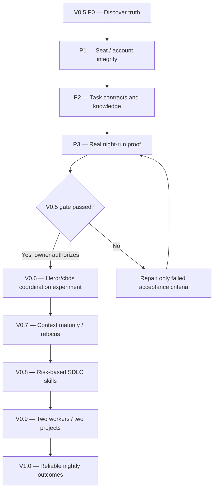

# MK Nightshift — phased roadmap

Planning baseline: 2026-10-19. Status: PROPOSED. Implement **nothing** merely because it appears here.

## Owner update — 2026-10-19: DEV-FIRST MVP (applies to one disposable P1A fixture)

The owner prioritizes **proving a working V0.5 Nightshift coding loop** on the existing OpenClaw development server, rather than further security-framework or multi-user setup. For **one manual disposable Codex TEST_ADD only**, use the existing `openclaw` user and privately owner-matched Codex CLI account, accept the explicitly documented residual same-user isolation risk, and run a single task with time/path limits, real host tests and local Git evidence. No new user, re-login, container, token decoding or renewed isolation reviews for this fixture. See [decision](decisions/DEV_FIRST_FIXTURE_POLICY_2026-10-19.md) and [one-task instruction](../../prompts/V0.5_P1A_DEV_SINGLE_TEST_ADD.md).

**Future hardening before broader unattended/sensitive use:** unprivileged worker isolation; reduced environment, mounts/sockets and egress; proof of headless identity where materially needed; service/timer and 6 AM Git merge safety. Existing `ISOLATION_NOT_VERIFIED` remains factually true. This temporary dev-first exception is not permission to access unrelated credentials, DBs, Telegram, services, or to push/merge/deploy.

## Definition of success

In the evening the owner approves one or two bounded issues. Overnight a verified, intended CLI account produces isolated, test-backed commits, or an honest blocker. In the morning a concise report cites real commits, commands, outcomes, identity evidence and next decisions. No unapproved promotion to production.

## Dependency graph

## V0.5 — Four gated phases

### P0: Verify truth and make project knowledge navigable (NO code edits in P0.1)
- **P0.1** Read-only inventory: orchestrator branch/HEAD/status, V0.4 runner/smoke/tests/timer, CLI help and auth viability (without exposing secrets), Herdr/cbds installed facts, existing host fixture evidence; NutriSnap branch pointers and conflicting docs.
- **P0.2** Architecture decision record: Python JSON runner is sole authoritative *night* dispatcher in V0.5; Herdr used for interactive control, cbds not dual-writing campaign state. Specify any proposed changes; no runtime edits yet.
- **P0.3** Propose a shallow NutriSnap `AGENTS.md` entrypoint to existing authoritative docs. Do not overwrite the NutriSnap repository without separate owner approval.
- **P0.4** Source-address map: app frontend/API, Prisma, shared scheduler, Python analysis API, Telegram adapter, isolated test setup, build/test commands. Each entry says verified/unverified.
- **P0.5** Evidence hierarchy: Git SHA + commands + logs for implementation, owner decisions for requirements, cbds or runner state for execution *only in the active chosen architecture*. No model narrative accepted as proof.
- **P0.6** Identify genuine blockers: verify both actual V0.4 smoke tasks `VERIFIED_COMMITTED` (not just `REVIEW_REQUIRED`), interruption recovery, account/profile, quotas, timer state, full real-project readiness.
- **P0 exit:** a fresh agent can locate the correct NutriSnap branch/SHA, reminders code, tests, non-goals and next approved issue in no more than two short entrypoint reads plus targeted links. Contradiction = HOLD.

### P1: Identity, chairs and handoffs
- Define **Owner** (intent/release), **Python Dispatcher** (only launcher), **Builder** (AGY-Rohit OR AGY-Manickam as verified selected), **Reviewer** (independent Codex when warranted).
- Registry fields: seat ID, real CLI executable/version, profile selector and redacted identity receipt, approved worktree, role/skill file, scoped task, time budget. Never store tokens, cookies or private authentication files in project docs.
- Worker requests a handoff, **dispatcher launches** real intended CLI; no nested/in-process agent substitution or undocumented quota fallback.
- Test both AGY identities in separate sandbox trials; test wrong profile, absent binary, expired login, duplicate task, invalid worktree and quota exhausted.
- **P1 exit:** attributable external launches for both account seats; wrong-identity negative test reliably BLOCKED. No real production changes.

### P2: Owner intent, issue and context contract
- One issue record: ID, desired user outcome and why, explicit approval, source branch/SHA, code/knowledge addresses, allowed paths, forbidden work, dependencies, acceptance commands, responsible seat, real question/decision route.
- Skills initially **three only**: Project Steward (find existing design first), Engineering Standards (SOLID/DRY/KISS/YAGNI/security and local conventions), SDLC Execution (plan/build/test/review/handoff). Load by task, not every skill every turn.
- Knowledge trust labels: PROPOSED (idea), OBSERVED (claim/measurement), VERIFIED (source/test backed), APPROVED (authorized product decision). VERIFIED is not automatic owner approval.
- Add a short **Lessons** note only for a reproducible failure: nested subagent substitution, stale V0.1 route, creating a second scheduler, lost review evidence, excessive architectural expansion.
- **P2 exit:** fresh AGY worker can find an existing service, explain the intended change, distinguish approved vs merely proposed behavior, ask one decision-quality question, and produce a bounded task plan.

### P3: Nightshift proof and safety
- Reproduce two disposable fixture tasks with **real headless CLI**, exact SHA, logs/tests and accepted report states. Mocked suite PASS does not satisfy live proof.
- One **separately approved** low-risk NutriSnap change in isolated Git worktree with isolated DB / mock integration. Run real deterministic tests; independent review only where risk warrants.
- Negative cases: timeout, quota, bad profile, dirty worktree, disallowed path, invalid tests, process interruption, misleading worker success, inability to continue safely.
- Fail closed; preserve evidence and changes on blocked worktree. Recovery may be **manual/explicit**. No silent reset/clean/retry.
- Verify server clock and systemd context. Timer installation/enabling requires separate owner approval and successful host preflight.
- Morning report must distinguish IMPLEMENTED/TESTED/REVIEW_REQUIRED/APPROVED/RELEASED, identify real worker label, exact commit, actual commands/results, known blockers and next owner decision.
- **V0.5 exit:** at least one real approved non-production Nightshift change verified, both account identities proved in separate trials, controlled interruption preserves evidence, no unauthorized actions, and owner explicitly authorizes V0.6.

## Later versions (ideas, not implementation permission)

| Version | Borrowed lesson | Smallest experiment | Exit |
|---|---|---|---|
| V0.6 | Durable addressable seats | Python boots Herdr panes and verified CLIs; cbds becomes sole task ledger **only for this separately authorized experiment** | Single question/reply/done handoff survives restart |
| V0.7 | Navigable world/context and epistemic maturity | Context refocus after restart/compaction; stale-pointer check; evidence-backed lessons | Fresh agent and resumed agent avoid duplicate feature |
| V0.8 | Consistent engineering | Kanban → design when needed → build → tests → risk-based review → owner acceptance; targeted skills | Feature completes SDLC without extra bureaucracy |
| V0.9 | Specialization only when useful | Two bounded non-overlapping workers and separate NutriSnap / MK Desk Pet maps | No worktree collisions or account confusion |
| V1.0 | Outcome over agent count | Short owner-approved backlog → unattended verified increments or blockers → morning review | Repeated useful night runs with traceable evidence |

## Stop conditions

Any conflicting authoritative SHA; inaccurate claim of a passed test; unexpected profile or nested agent substitution; product decision requiring owner input; failure to isolate database or credentials; dirty/unowned worktree; exhausted quota; stale/competing dispatch state; attempted auto-merge/deployment; unauthorized scope enlargement.

## Every phase report (keep compact)

1. Phase/step and date, inspected exact Git branch/HEAD.
2. Confirmed facts + evidence paths, unknowns clearly separated.
3. Tests really run (command/exit status) and NOT_RUN items.
4. Risk, blocker, owner decision required.
5. Recommendation: PASS / FAIL / BLOCKED / NOT_STARTED.
6. Only **one next proposed step**; do not dispatch it until authorized.
