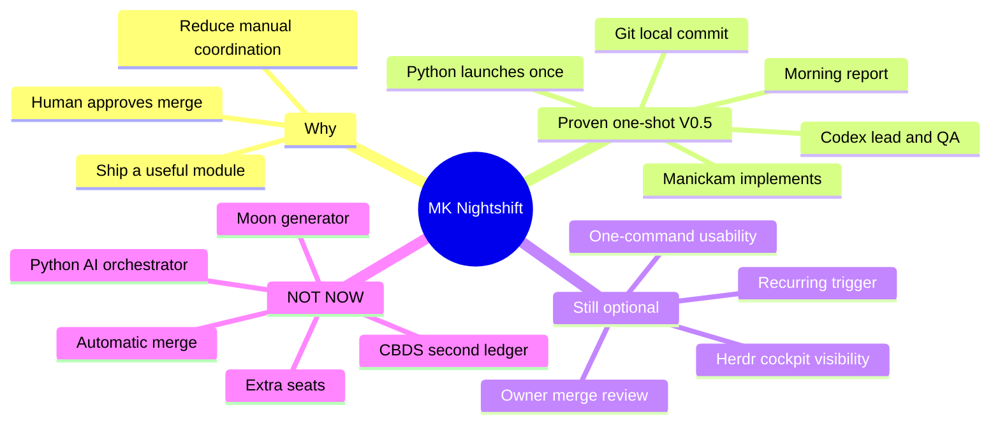
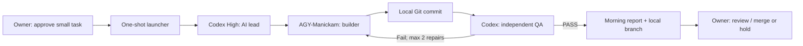

# START HERE — Nightshift / NutriSnap 22 Oct 2026

**LATEST W04 EXECUTION UPDATE (2026-10-22):** The first W04 attempt halted without dispatch because Manickam's Herdr agent was absent; read the [ONE-GO worker recovery + W04 runbook](V05_ONE_GO_SEAT_RECOVERY_W04_2026-10-22.md) instead of stopping at the now-superseded no-new-seat rule. Original Nightshift V0.5 one-shot stays PASS.
**LATEST UPDATE — Astra review DONE, Oct 22:** local review at `/home/openclaw/worktrees/agent-orch-v05-p0/docs/v0.5/OCT22_VERIFIED_STATUS_AND_DECISIONS.md` (owner-reported commit `eb9b57a5205ba11a2d83dc791b930460d796123`) confirmed V0.5 one-shot DONE with `REVIEW_REQUIRED`. No second architecture review. **Next is the [W04 complete autonomous hydration run plan](W04_HYDRATION_COMPLETE_RUN_PLAN_2026-10-22.md)**, executed with GPT-6.1-Sol High, followed by one QA report. No push/merge/scheduling.

## Build a doghouse lamp, not a moon generator

**Purpose:** A short, evidence-led reset before spending more Codex quota. The doghouse lamp is a **metaphor**, NOT a pet-hardware requirement. If the need is "a dog needs light in its shelter," deliver a switch, suitable light and safe power—not a moon generator, a power company and twelve teams. Apply exactly that simplicity test to Nightshift: owner task → builder commit → independent QA → owner report.

**This file is a reference and discussion log on the remote *instruction branch*.** OpenClaw local branches/worktrees contain the working unpushed code. Codex must inspect the local source of truth read-only and record mismatches, not overlay this remote branch, merge it or reset local work.

## 1. Honest status as of 22 Oct (based on owner-provided host reports)

| Item | Actual reported evidence | Decision |
|---|---|---|
| NS-01 | NutriSnap `0ff42c6a28d203e3ccaf9cc37fba2ae693ddeb2d`; AGY build → Codex QA PASS | **Done** |
| NS-02 | NutriSnap `8372df220e9117725bd472dd6b430e3f8c444bf5`; 1 Codex-led repair → QA PASS | **Done** |
| Gate B | Launcher `b3e91d44d0ab5d474578ccc0de5f62f2a3e7402f`, 22 offline tests PASS | **Done** |
| Gate C | Readiness repair `45d7e8285617d1c231417d2ed643d7581d740911`, 25 launcher tests PASS; AGY code `9934c6261c728c5a0dba9954b781a8b03fe29c12` with 107 finance, 74 reminder, 13 focused tests, 7 browser checks PASS | **One-shot V0.5 live proof PASS (owner reported)** |
| Gate C report | `/var/tmp/mk-nightshift-gate-c.RKWCkt/Extended20261020R1/morning.md`; `docs/v0.5/evidence/GATE_C_EXTENDED_NUTRISNAP_RESULT.md`; `REVIEW_REQUIRED` | **Owner merge decision remains** |
| Herdr cockpit | Existing Codex `wD:p1`, Manickam `wD:p2`, status shell `wD:p5` reported; 0 new startups for Gate C | **No new tab expected; actual visible session connection not yet verified** |
| Automation | ONE manually initiated live one-shot proof. `PUSH_HOLD`; no push/merge/deploy/cron | **Recurring hands-off schedule NOT implemented or approved** |

**Important:** The remote `docs/v0.5/ROADMAP.md` still predates the later host-reported Gate C PASS; don't let stale GitHub docs reopen H1–H5 or trigger another Gate C. Local commit SHAs and actual reports should be checked before asserting they exist. Code changes were not pushed to this remote planning branch.

## 2. Mind map — from goal to useful delivery

## 3. How to choose today's work — 87% quota remaining until ~18:00 IST (owner-stated)

**Model choice from owner's Codex menu:**
- **GPT-6-Astra**: **one bounded high-effort architecture/product review**, to compare *verified current code and reports* with the simple flow; no speculative rewrite.
- **GPT-6.1-Sol**: use for the **implementation and tests** following the review. It's the latest coding workhorse shown in the owner's menu. Do not repeatedly switch models or spend the entire quota on design.
- A model name or reasoning-effort label is **not evidence of account quota/token cost**. Watch the CLI's actual meter; preserve budget for coding and independent testing.

**Today's realistic goal:** Close the local truth gap and identify **one** useful, owner-approved next slice (prefer real NutriSnap behavior); do not build another model/agent orchestration layer. After read-only review, use Sol for scoped implementation under a separate concrete task authorization. No unsanctioned recurring scheduling or production operations.

**DOGHOUSE-LIGHT acceptance test for any proposed change:**
1. What user-visible failure or recurring manual burden is being fixed?
2. Can the existing Codex + Manickam + one-shot launcher solve it with fewer components?
3. What exact test/demo proves success and what constitutes done?
4. What can we **delete, defer or reuse**? If the proposal adds a framework, seat, worker queue, orchestration DB or approval stage without clear evidence, reject it.

## 4. Focused architecture review — ONE pass, not a new phase

Review the exact OpenClaw-local launcher, Herdr detection, task packet and Gate C report. **Do not rewrite** them if the one-shot result is sound. Produce:
- A **truth table**: confirmed V0.5 capabilities / gaps / evidence refs; avoid assumptions or claims that the UI showed tabs.
- Up to **5 genuine defects or operational friction points**, prioritized by impact and demonstrated evidence, with *fix now / defer* decisions. No speculative 50-item hardening backlog.
- **One simple owner workflow**: where to enter a task, how to initiate a one-shot run, where to see in-flight status and how to review the local commit/morning report. Verify actual commands locally; don't invent CLI syntax.
- A **small next NutriSnap deliverable** chosen from real code/backlog, with acceptance criteria and max two repair cycles. Prefer a feature, not another artificial time parser test.
- An updated **short local Git doc** (`docs/v0.5/OCT22_VERIFIED_STATUS_AND_DECISIONS.md`) containing findings/mind map/questions. Work only in the existing safe local orchestration worktree/branch or a safe docs branch; preserve unpushed host code, `PUSH_HOLD` and NutriSnap worktrees. Make **one local documentation commit only** after scoped read-only review if safe, not an application code or deployment commit.

## 5. Question ledger — answer from evidence first; ask owner only if it changes the next action

| ID | Question | Best current answer / needed proof | Who decides |
|---|---|---|---|
| Q1 | Do Gate C final launcher exit and run-specific receipts confirm `REVIEW_REQUIRED` without an unseen failure? | Inspect the already-recorded receipt and exit log **read-only**; no rerun | Codex |
| Q2 | Which local NutriSnap commits are ready for a manual merge review, and what is the diff/target relative to main? | Inspect actual local Git graph and changed files. **Do not push/merge** | Codex reports; owner merges |
| Q3 | What is the simplest supported way to start the next one-shot task and view status in the existing Herdr cockpit? | Inspect installed CLI and exact available session; do not create panes for visual decoration | Codex |
| Q4 | Which ONE next real NutriSnap module should we build after current Bills & Reminders PASS? | Propose based on current local code and backlog, with a minimal definition of done | Owner chooses if competing |
| Q5 | Do we want unattended nightly scheduling now? | **Not authorized**. Propose minimal future toggle only after owner decides; no cron installation in this review | Owner |

**Do not ask owner to reapprove already-proven H1–H5, NS-01, NS-02 or Gate C.** Only surface one genuinely blocking product/schedule decision after the review.

## 6. Codex instructions — read this in Git; no giant prompt to paste

1. Open **existing** `MKCyberLabs/agent-orchestration-lab` project on the OpenClaw VM. Confirm the real current local branch and `git status`. Fetch **instruction branch only** if needed; `git show origin/planning/v0.5-p0-handoff-20261019:docs/v0.5/START_HERE_2026-10-22_DOGHOUSE_LIGHT.md` for this document. **Do not merge/rebase/reset local source.**
2. Use **GPT-6-Astra** for one *read-only architecture/product audit*, with results recorded locally in `docs/v0.5/OCT22_VERIFIED_STATUS_AND_DECISIONS.md`. Fill the five question rows using evidence; only owner-only choices stay open. Create one safe local docs commit if appropriate, without pushing.
3. Return a **short terminal summary**: `V0.5 DONE / OPEN`, next useful NutriSnap module, verified one-command run instructions, remaining owner question (if any), documentation local commit SHA. STOP. For real feature coding after approval, switch to **GPT-6.1-Sol**.

**Hard exclusions:** No new Python orchestration, no CBDS, no AGY/Codex starts or prompts during this audit, no new worktree unless required to protect an occupied checkout, no trust automations, no hidden retry, no live DB changes, no release/push/merge/deploy/scheduled jobs. This isn't another Nightshift approval gate.
